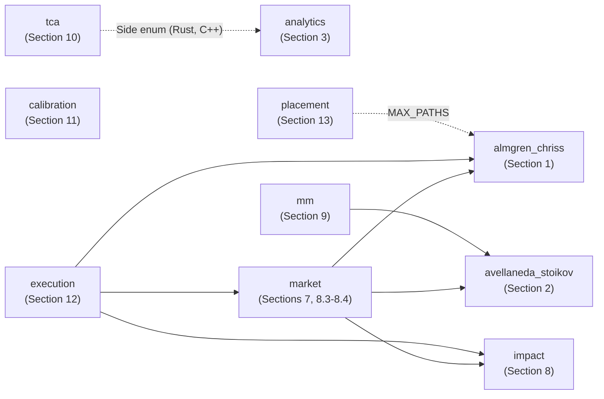
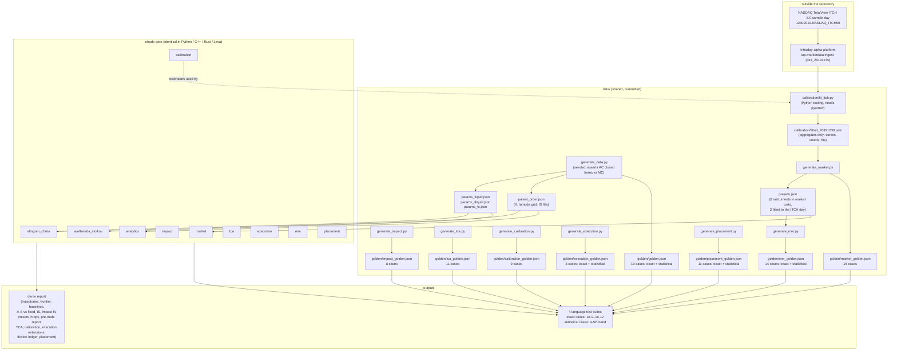
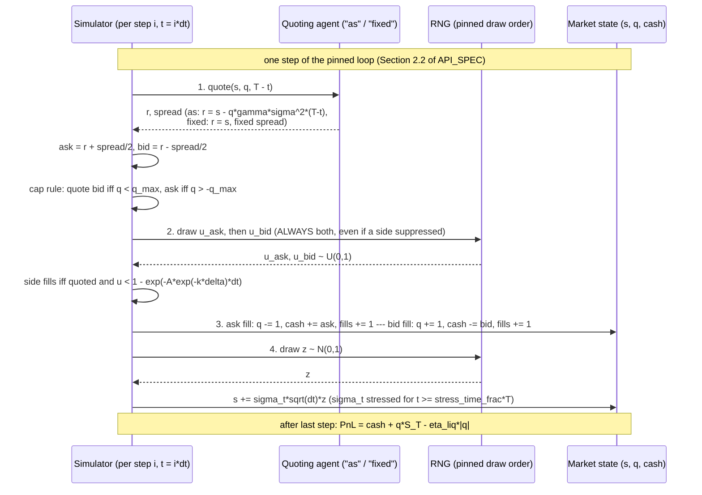

# ARCHITECTURE — `etrade`

Design notes for the four parallel implementations (Python reference, C++,
Rust, Java) of the Almgren-Chriss / Avellaneda-Stoikov / analytics stack,
the power-law impact model, the market-unit layer, post-trade TCA,
calibration from recorded data, the execution extensions (transient
impact, adaptive re-planning, internalisation), market making with
frictions, and limit-order placement.
The normative contract is `../API_SPEC.md`; this document explains *why* it
is shaped the way it is.

## 1. Component responsibilities

Ten modules per language, mirrored one-to-one across ports:

| Module | Owns | Depends on |
|---|---|---|
| `almgren_chriss` | `ACParams` validation (incl. size bounds), `kappa` (`log1p` form), `exp/expm1`-form sinh trajectory with exact TWAP branch, trade lists, exact discrete E/Var sums, TWAP/POV/instantaneous baselines, efficient frontier, Monte Carlo IS check | RNG (MC only) |
| `avellaneda_stoikov` | `ASParams` validation, reservation price / optimal spread / quotes closed forms, intensity and fill probability, the pinned path simulation with inventory cap, stress vol and terminal liquidation, per-path and aggregate statistics | RNG (simulation only) |
| `analytics` | Perold IS decomposition (buy/sell), participation rate, native closed-form OLS, pinned RNG-free synthetic impact fills | nothing stochastic |
| `impact` | power-law temporary impact with per-interval liquidity weights, linear permanent impact and adverse drift; exact cost and variance of any sell schedule; pinned Newton solver (tridiagonal Hessian, Armijo line search, decrement stop) with horizon bisection and a KKT certificate; VWAP schedule; square-root-law estimate (API_SPEC Section 8) | nothing (its own parameter type) |
| `market` | conversion from market units (price, spread, tick, ADV, daily vol, touch fill rate, halving distance, opening skew) to `ACParams`/`ASParams`/`ImpactParams`; bps and half-spread reporting helpers (API_SPEC Section 7); pre-trade report (Section 8.4) | `almgren_chriss`, `avellaneda_stoikov` (parameter types, `twap_holdings`), `impact` |
| `tca` | post-trade slippage against arrival, market VWAP, interval VWAP and close; markouts per fill and per share; per-bin participation; Welch t-test with a pinned `ln_gamma` (Lanczos), regularised incomplete beta (modified Lentz) and Student t CDF (API_SPEC Section 10) | nothing (C++ and Rust reuse the `Side` enum of `analytics`; Python and Java take the side as a string) |
| `calibration` | the pinned binning rule; volume curve, realised-volatility curve, spread statistics and the weighted log-linear fill-intensity fit, all on plain arrays; `FITTED_VOLUME_CURVE_13` (API_SPEC Section 11) | nothing |
| `execution` | `TransientParams` (Obizhaeva-Wang) with exact cost and the Thomas-solved static optimum; `SignalParams`, the linear re-plan and its coefficients, the paired static-vs-adaptive simulation; `internalise` (API_SPEC Section 12) | `almgren_chriss` (`ACParams`, `MAX_PATHS`), `impact` (cost, VWAP schedule), `market` (`impact_params_from_market`, `bps`) |
| `mm` | market making with frictions: `MMConfig` (agent `as`/`glft`/`fixed`, tick, maker fee or rebate, quote latency, informed-flow probability, signal accuracy), tick rounding away from fair value, GLFT closed-form half spreads, the pinned simulation loop with its exact per-path attribution `pnl = spread + fees + inventory - liquidation` and one-step markout, weighted mid and order-flow imbalance (API_SPEC Section 9) | `avellaneda_stoikov` (`ASParams`, the A-S closed forms, `MAX_PATHS`) |
| `placement` | fill probability of a resting order by queue position (pinned uniformisation), passive-or-aggressive decision for one child order, `LiquidationParams` with the backward-induction policy for liquidating with limit and market orders, the all-market schedule and the paired three-strategy simulation (API_SPEC Section 13) | `almgren_chriss` (`MAX_PATHS` only) |

The four model modules (`almgren_chriss`, `avellaneda_stoikov`, `analytics`,
`impact`) do not import each other, and neither do `tca` and `calibration`,
which work on plain arrays. `market` builds the model parameter objects
and, for the pre-trade report, calls the `impact` cost and schedule
functions. `execution` is the only module above `market`: internalisation
prices each side with the Section 8 cost of a VWAP schedule built from
market inputs, and the adaptive simulation takes an `ACParams`. `mm` sits
on `avellaneda_stoikov` (it reuses `ASParams` and the A-S quotes) and
`placement` imports only the path bound. Parameter objects are immutable value
types (frozen dataclasses in Python, plain structs/records elsewhere) that
validate **at construction**, so every downstream function can assume valid
inputs and stay branch-free. Functions that take user data (holdings paths,
grids, quote state, volumes) validate it at entry — finiteness, lengths,
liquidation, and the pinned size bounds of `API_SPEC.md` Section 0, checked
*before* any cast or allocation so that an absurd request (a POV clip of
1e-9 shares, `usize::MAX` paths) is an input error rather than undefined
behaviour, an integer overflow, an out-of-memory abort or a panic. The only
shared state anywhere is the RNG inside a single simulation call.

### Module dependencies

An arrow points from a module to one it imports. The graph is acyclic and
the same in every language; `calibration` is also imported by the Python
tooling `data/calibration/fit_itch.py`, which is not part of the library.

### Data flow

Eight Python scripts are the single source of truth for the bundled JSON.
`generate_data.py` writes the parameter sets, the parent order and the model
golden values (after asserting the AC closed forms against its own Monte
Carlo), all seeded; `generate_market.py` writes `presets.json` and the market
golden cases; `generate_impact.py`, `generate_tca.py`,
`generate_calibration.py`, `generate_execution.py`, `generate_mm.py` and
`generate_placement.py` write the golden cases of Sections 8 and 10-13
(`generate_mm.py` reads the `us_large_cap` preset from `presets.json`). Ports never regenerate data; they only
consume it.

**From an ITCH file to a preset.** The recorded data never enters the
repository. The NASDAQ sample file is ingested by the sibling project
intraday-alpha-platform into a normalised event dataset outside this
repository. `data/calibration/fit_itch.py <dataset_dir>` (Python only,
needs `pyarrow`) rebuilds the top of book, turns the continuous session into
plain arrays and calls the `calibration` estimators. Its only output is
`data/calibration/fitted_20191230.json`: per-symbol aggregates, curves and
bucket counts, which cannot reconstruct the messages (API_SPEC 11.6 on
"Derived Data"). `generate_market.py` reads that file, combines each symbol
with a template preset for the inputs a single day cannot fit (order size,
`lambda_ra`, the A-S skew, cap, liquidation penalty and step), and writes
`itch_aapl_20191230`, `itch_msft_20191230` and `itch_qqq_20191230` into
`data/presets.json`, each with a `source` field, plus their six market
golden cases. Re-running the fit needs the external dataset; re-running the
generators does not.

### Golden-file inventory

Every file has the schema `{"cases": [{name, kind, inputs, expect, tol}]}`
(API_SPEC Section 5). Exact cases pass when
`|got - expected| <= tol * max(1, |expected|)`; statistical cases store a
20,000-path Python reference with its standard error and pass when
`|got - ref| <= tol * sqrt(se_ref^2 + se_own^2)` with `tol = 4`. Every suite
asserts the case count of every file and that each case is handled.

| file | generator | cases | kinds (count) | tolerance | spec |
|---|---|---|---|---|---|
| `golden.json` | `generate_data.py` | 19 | `exact` (15), `statistical` (4) | 1e-10 or 1e-12; 4 SE | 1-3, 5 |
| `market_golden.json` | `generate_market.py` | 15 | `market_ac` (8), `market_as` (7) | 1e-12 | 7.4, 11.7 |
| `impact_golden.json` | `generate_impact.py` | 8 | `impact_schedule` (5), `impact_vwap` (1), `pretrade` (1), `sqrt_law` (1) | 1e-9 | 8.5 |
| `tca_golden.json` | `generate_tca.py` | 11 | `slippage` (2), `markout` (2), `participation` (1), `welch` (2), `t_cdf` (4) | 1e-12 | 10.6 |
| `calibration_golden.json` | `generate_calibration.py` | 9 | `cal_volume_curve` (2), `cal_volatility` (2), `cal_spread` (2), `cal_fill_intensity` (2), `cal_fitted_curve` (1) | 1e-12 | 11.7 |
| `execution_golden.json` | `generate_execution.py` | 8 | `transient_schedule` (3), `internalise` (2), `adaptive_sim` (3) | 1e-9; 4 SE | 12.4 |
| `mm_golden.json` | `generate_mm.py` | 14 | `mm_tick` (3), `mm_glft` (3), `mm_wmid` (1), `mm_ofi` (1), `mm_sim` (6) | 1e-12; 4 SE | 9.7 |
| `placement_golden.json` | `generate_placement.py` | 11 | `fill_probability` (4), `placement_decision` (3), `liquidation_policy` (2), `liquidation_sim` (2) | 1e-10; 4 SE | 13.4 |

95 cases in all. The case names say what each pins: for example
`welch_constant_sample` (one sample with zero variance, the other not),
`t_cdf_negative_fractional_df` (a negative `t` with non-integer degrees
of freedom),
`cal_spread_even_effective` (the even-count median),
`cal_fill_intensity_two_days` (the `days` normalisation),
`transient_slow_resilience` (`a` close to 1), `internalise_balanced_curve`
(`B = S`, residual side `none`), `adaptive_no_signal` (saving exactly 0),
`mm_sim_latency` (quotes one step stale), `fill_no_cancellations` (the
Poisson-tail case) and `decision_aggressive_zero_spread` (crossing wins
with no spread).

### Module surface

```mermaid
classDiagram
    class ACParams {
        +float total_shares
        +int n_intervals
        +float tau
        +float sigma
        +float eta
        +float gamma_p
        +float lambda_ra
        +horizon() float
        +eta_tilde() float
        +with_lambda(lambda_ra) ACParams
    }
    class almgren_chriss {
        +ac_kappa(p) float
        +half_life(p) float
        +characteristic_time(p) float
        +ac_trajectory(p) array
        +ac_trade_list(p) array
        +twap_holdings(X, N) array
        +pov_holdings(X, tau, V, p) array
        +expected_cost(p, holdings) float
        +variance_cost(p, holdings) float
        +instantaneous_cost(p) tuple
        +efficient_frontier(p, lambdas) FrontierPoint[]
        +simulate_is(p, holdings, n_paths, seed) ISSimResult
    }
    class FrontierPoint {
        +float lambda_ra
        +float kappa
        +float e_cost
        +float var_cost
        +float std_cost
    }
    class ISSimResult {
        +float mean
        +float var
        +float se_mean
        +float se_var
        +int n_paths
    }
    class ASParams {
        +float s0
        +float sigma
        +float horizon
        +float dt
        +float gamma
        +float k
        +float a_rate
        +int q_max
        +float eta_liq
        +n_steps() int
    }
    class avellaneda_stoikov {
        +reservation_price(p, s, q, t) float
        +optimal_spread(p, t) float
        +quotes(p, s, q, t) tuple
        +intensity(p, delta) float
        +fill_probability(p, delta) float
        +average_as_spread(p) float
        +simulate(p, n_paths, seed, agent, ...) ASSimResult
    }
    class ASSimResult {
        +array pnl
        +array rms_q_path
        +float mean_pnl
        +float std_pnl
        +float sharpe
        +float mean_abs_q
        +float mean_max_abs_q
        +float rms_q
        +float mean_fills
        +bool cap_violated
        +se(stat) float
    }
    class analytics {
        +decompose_shortfall(side, Pd, P0, PT, X, qtys, prices) ISDecomposition
        +participation_rate(exec, mkt) float
        +ols(x, y) OLSResult
        +synthetic_impact_fills(n, a, b, amp) tuple
        +estimate_impact(parts, costs) OLSResult
    }
    class ISDecomposition {
        +float total
        +float delay
        +float trading
        +float opportunity
        +float executed_qty
        +float remaining_qty
    }
    class OLSResult {
        +float slope
        +float intercept
        +float r_squared
        +int n_obs
    }

    class ImpactParams {
        +float total_shares
        +int n_intervals
        +float tau
        +float sigma
        +float eta
        +float alpha
        +float gamma_p
        +float lambda_ra
        +float drift
        +weights
        +etas() float[]
    }
    class impact {
        +impact_expected_cost(p, holdings) float
        +impact_variance_cost(p, holdings) float
        +vwap_holdings(X, weights) array
        +optimal_schedule(p) ScheduleResult
        +sqrt_law_cost_bps(daily_vol, Q, adv, y) float
    }
    class ScheduleResult {
        +array holdings
        +int horizon
        +int iterations
    }
    class market {
        +ac_params_from_market(...) ACParams
        +as_params_from_market(...) ASParams
        +impact_params_from_market(...) ImpactParams
        +bps(amount, notional) float
        +half_spread_cost(spread, X) float
        +pretrade_report(..., lambdas) PretradeReport
    }
    class PretradeReport {
        +float sqrt_law_bps
        +float half_spread_bps
        +PretradeRow[] rows
    }

    class tca {
        +slippage(side, arrival, close, fills, bins) SlippageReport
        +markouts(side, steps, qtys, mids, horizons) MarkoutResult
        +participation(bins, qtys, volumes) ParticipationResult
        +welch_ttest(a, b) WelchResult
        +student_t_cdf(t, df) float
        +betainc_reg(a, b, x) float
        +ln_gamma(x) float
    }
    class calibration {
        +volume_curve(times, sizes, t0, t1, n_bins) float[]
        +volatility_curve(times, mids, t0, t1, n_bins) VolatilityCurve
        +spread_stats(spreads, mids, tick) SpreadStats
        +fill_intensity(distances, tick, n_levels, days, sides) FillIntensity
        +FITTED_VOLUME_CURVE_13
    }
    class TransientParams {
        +float total_shares
        +int n_intervals
        +float tau
        +float kappa
        +float rho
        +float gamma_p
        +decay() float
    }
    class SignalParams {
        +float phi
        +float signal_sd
        +float fill_risk
    }
    class execution {
        +transient_expected_cost(p, holdings) float
        +transient_optimal_schedule(p) array
        +replan(p, sig, holding, signal, k) array
        +replan_coefficients(p, sig) tuple
        +simulate_adaptive(p, sig, n_paths, seed) AdaptiveSimResult
        +internalise(buys, sells, market inputs) InternalisationResult
    }
    class MMConfig {
        +agent
        +float tick
        +float maker_fee
        +int latency_steps
        +float informed_prob
        +float signal_accuracy
        +float fixed_spread
    }
    class mm {
        +round_to_tick(bid, ask, tick) tuple
        +glft_half_spreads(params, q) tuple
        +weighted_mid(bid, ask, bid_size, ask_size) float
        +order_flow_imbalance(bid_px, bid_sz, ask_px, ask_sz) array
        +simulate_mm(params, n_paths, seed, config) MMResult
    }
    class LiquidationParams {
        +int total_units
        +int n_periods
        +float dt
        +float sigma
        +float spread
        +float kappa
        +float p_touch
        +float beta
        +float phi
    }
    class placement {
        +queue_fill_probability(q_ahead, size, mu, theta, horizon) float
        +place_or_cross(size, spread, fill_prob, adverse_move, eta, alpha, weight) PlacementDecision
        +liquidation_policy(p) LiquidationPolicy
        +aggressive_cost(p) float
        +simulate_liquidation(p, n_paths, seed) LiquidationSimResult
    }

    almgren_chriss ..> ACParams : validates on construction
    almgren_chriss --> FrontierPoint
    almgren_chriss --> ISSimResult
    avellaneda_stoikov ..> ASParams : validates on construction
    avellaneda_stoikov --> ASSimResult
    analytics --> ISDecomposition
    analytics --> OLSResult
    impact ..> ImpactParams : validates on construction
    impact --> ScheduleResult
    market --> ACParams
    market --> ASParams
    market --> ImpactParams
    market --> PretradeReport
    tca --> SlippageReport
    tca --> WelchResult
    calibration --> FillIntensity
    execution ..> TransientParams : validates on construction
    execution ..> SignalParams : validates on construction
    execution --> AdaptiveSimResult
    execution --> InternalisationResult
    execution --> ACParams
    execution --> market
    mm ..> MMConfig : validates on construction
    mm --> ASParams
    mm --> MMResult
    placement ..> LiquidationParams : validates on construction
    placement --> PlacementDecision
    placement --> LiquidationPolicy
    placement --> LiquidationSimResult
```

## 2. The pinned A-S simulation loop

Cross-language reproducibility of a *stochastic* simulation is the hardest
part of this project. The loop below is pinned to the operation: any
reordering (quoting after the mid move, drawing `u_bid` before `u_ask`,
skipping a suppressed side's draw) produces statistically different — or
subtly stream-forked — results.

Design points:

- **Always-draw rule.** Both uniforms are consumed every step regardless of
  the cap state, so the random stream is a pure function of
  `(seed, n_paths, n_steps)` and does not fork the first time a path hits
  `q_max`. This makes the A-S vs fixed-spread comparison a controlled
  experiment on the *same* randomness per (seed, agent).
- **Cap by construction.** The bid is suppressed at `q >= q_max`, the ask at
  `q <= -q_max`, so `|q| <= q_max` is an invariant, and the simulation still
  *asserts* it every step (`cap_violated` flag) — belt and braces, and a
  cheap tripwire for port bugs.
- **Stress as misspecification.** `stress_factor` scales only the realised
  `sigma_t` in step 4; the agent's formulas keep the base sigma. This
  isolates "the world changed and the model didn't notice" from "the model
  was re-calibrated".
- **Vectorisation across paths.** Python draws per-step *vectors* across
  paths (`u_ask` vector, `u_bid` vector, `z` vector) — ~200 numpy ops per
  simulated step instead of a million Python-level iterations. Native ports
  loop per path with the same *logical* per-step draw order; that is exactly
  why cross-language agreement is defined statistically, not bitwise.

## 3. Numerical design decisions and trade-offs

1. **Exact discrete sums as the single code path.** `E[IS]` and `Var[IS]`
   are always evaluated through
   `(1/2)gamma_p X^2 + (eta_tilde/tau) sum n_j^2` and
   `sigma^2 tau sum x_j^2`. For the optimal trajectory these coincide with
   the paper's hyperbolic closed forms (evaluated with the discrete kappa)
   to machine precision — rel. diff 2e-16 on the liquid set, asserted at
   1e-12 by every suite as a literature check. The sums are pinned because
   one code path covers optimal, TWAP, POV and hand-built schedules, so
   there is one set of invariants to test. Only the *continuous* kappa
   substituted into the closed forms is an approximation.
2. **`log1p` form for kappa.** `kappa = arccosh(1 + x)/tau` with
   `x = kappa_tilde^2 tau^2/2` is the exact root of the discrete
   characteristic equation — no iterative solve, no tolerance to pin. It is
   evaluated as `log1p(x + sqrt(x(2 + x)))/tau`, which is the same function
   but free of cancellation for small `x` (a few ulp); the literal `acosh(1 + x)` loses
   `~eps/x` relative digits by cancellation, i.e. it degrades *worst*
   exactly as `tau -> 0` (measured: `x = 2e-9` gives 1.2e-8 relative error,
   above the 1e-10 golden tolerance; `x = 5e-16` gives 6%). Golden case
   `ac_kappa_small_tau` pins this.
3. **`exp/expm1` form for the sinh ratio.** `sinh(kappa(T-t_j))/sinh(kappa T)`
   overflows to `inf/inf = NaN` at `kappa T > 710` — a very urgent schedule or a
   very long horizon (`kappa T` is essentially grid-independent at fixed `T`). It is evaluated as
   `exp(-kappa t_j) expm1(-2 kappa (T-t_j)) / expm1(-2 kappa T)`, identical
   for every `kappa > 0`, finite for every valid input, with the ratio formed
   first so `x_0 == X` exactly. Far out on a very urgent schedule `exp`
   underflows and `x_j` is exactly 0 — correct, and documented.
4. **Explicit TWAP limit branch.** The ratio is 0/0 at `kappa = 0`, so
   `kappa*T < KAPPA_T_LIMIT = 1e-6` switches to the exact linear schedule.
   The threshold is pinned in the spec (a port choosing 1e-8 would still
   pass goldens today, but the branch point is observable in principle, so
   it is contract, not implementation detail). Continuity across the branch
   is a dedicated test.
5. **`x_N = 0` exactly.** The last holding is forced to zero after
   evaluating either branch, so "fully liquidates" is exact rather than
   epsilon-true, and the liquidation check `|x_N| <= 1e-9 max(1, X)` on
   user-supplied schedules (in `expected_cost` *and* `simulate_is`) never
   trips on our own output.
6. **`log1p` / `expm1` everywhere they matter.** The A-S markup
   `(2/gamma) ln(1 + gamma/k)` and fill probability `1 - exp(-lambda dt)`
   are computed as `log1p` and `-expm1`; with FX-scale inputs
   (`gamma/k = 0.05`, `lambda*dt ~ 1e-3`) naive forms lose enough digits to
   break 1e-12 goldens. The exact thinned probability is also a documented
   divergence from the paper's first-order `lambda dt` (see LEARN 6.4).
7. **Fills are counted per side.** `mean_fills` is the total number of
   fills (a both-sides step counts two). The original Python reference
   summed numpy *bool* arrays — a logical OR — and the ports had copied the
   OR to match the golden; that undercounted by ~10% on the liquid set
   (77.2 vs 85.5). The fix is pinned in `API_SPEC.md` 2.2, the golden was
   regenerated, and a saturated-book test (P(fill) = 1 on both sides →
   fills = 2·n_steps exactly) plus an independent scalar re-implementation
   of the loop in the Python suite keep the OR from coming back.
8. **Pinned size bounds.** `MAX_AC_INTERVALS`, `MAX_POV_INTERVALS`,
   `MAX_AS_STEPS`, `MAX_PATHS` (all 10 million) are checked on the *double*
   ratio before any `ceil`/cast/`new`/`Vec::with_capacity`. Without them
   `pov_holdings(1e6, 1, 1, 1e-9)` was a `MemoryError` in Python,
   float→int UB in C++, a capacity-overflow abort in Rust and a
   `NegativeArraySizeException` in Java.
9. **ddof = 1 sample moments, pinned SE formulas.** SE of a per-path-mean
   statistic is `sample std / sqrt(M)`; `SE(std_pnl)` and `SE(var)` use the
   normal approximation (`std/sqrt(2(M-1))`, `var*sqrt(2/(M-1))`). Pinning
   the SE formulas is what makes the 4-SE acceptance band well defined
   across languages.
10. **Money in whole currency units, shares in floats.** No basis-point or
    per-share normalisation inside the model modules: E and Var come out in
    currency, letting the golden values assert the raw sums. Conversion to
    basis points happens only in `market` (`bps`, the pre-trade report) and
    in the demos.
11. **A pinned solver where there is no closed form.** The power-law model
    has no closed-form optimum, so the algorithm itself is the contract
    (`API_SPEC.md` Section 8.2): Newton steps on the tridiagonal Hessian
    (Thomas algorithm, O(N) per step), Armijo backtracking that keeps every
    trade strictly positive, fixed stopping tolerances and an iteration cap.
    The problem is convex, so any port that follows the steps lands on the
    same point to well within the 1e-9 golden tolerance. When a drift makes
    finishing early optimal, the horizon is found by bisection and certified
    with the KKT condition instead of trusted. `alpha = 1` with uniform
    weights is asserted against the closed-form Almgren-Chriss trajectory,
    and the Python suite cross-checks the solver against SciPy.

    *Why a KKT certificate.* With a drift the optimum may finish at some
    `m < N`, and on a shorter horizon the Newton iteration can fail for two
    different reasons: the horizon is infeasible (a trade would have to be
    negative), or the solver is broken. Bisection on `m` finds the largest
    horizon on which Newton converges with all trades strictly positive;
    the certificate then checks the one inequality that makes stopping
    there optimal, that the marginal cost of the last trade does not exceed
    the drift saved by finishing, `c_m'(n_m) <= drift * tau (1 + 1e-9) +
    1e-12`. The problem is convex, so a point that passes is the global
    optimum; a point that fails is reported as a solver error rather than
    returned. With `drift = 0` the full horizon must converge, and any
    failure is an error.
12. **Transient impact: an exact tridiagonal solve, not an optimiser.** The
    Obizhaeva-Wang cost is the quadratic form `n' A n / 2` with
    `A = kappa K - gamma_p I` and `K_ij = a^|i-j|`. `K` is a
    Kac-Murdock-Szego matrix, and `(1 - a^2) K^{-1}` is tridiagonal, so
    `A y = 1` is multiplied through by that inverse into a tridiagonal
    system (`API_SPEC.md` 12.1) solved by the Thomas algorithm in O(N).
    There is no iteration and no tolerance. The system is strictly
    diagonally dominant exactly when the validity condition
    `gamma_p < kappa (1 - a)/(1 + a)` holds, which is also what makes Thomas
    stable without pivoting; the constructor rejects every other input, so
    the solve can assume it. `b = 1 - a` is evaluated as `-expm1(-rho tau)`
    so that slow resilience (`a` near 1, golden `transient_slow_resilience`)
    does not lose digits. The `gamma_p = 0` closed form
    `n ~ [1, 1-a, ..., 1-a, 1]` and the `a = 0` reduction to TWAP are
    asserted in every suite as literature and consistency checks.
13. **Adaptive re-planning: precomputed linear coefficients.** The re-plan
    is a Thomas solve of an `(m-1)`-system whose right-hand side is linear
    in the holding `h` and the signal `s`, so its first step is
    `c_m h - d_m s`. `replan_coefficients` solves the two unit right-hand
    sides once per `m`, and the simulation then costs O(N) per path instead
    of O(N^2). The static plan is the re-plan at `k = 0`, `s = 0`, and is
    asserted equal to the Section 1.4 trajectory to `1e-9 X`; with no signal
    and no fill risk the two strategies are asserted identical path by path,
    which is the test that the coefficients are right.
14. **The t CDF without a special-function library.** Welch p-values need
    the Student t CDF, and the four languages do not share a statistics
    library (C++ and Java have none in the standard library). The contract
    therefore pins the algorithm (`API_SPEC.md` 10.4): `ln_gamma` by
    Lanczos with `g = 7` and nine coefficients, the regularised incomplete
    beta by the modified Lentz continued fraction of *Numerical Recipes*
    (with the symmetry switch at `x = (a+1)/(a+b+2)`, which keeps the
    fraction in its fast-converging region, and `1e-300` guards against
    division by zero), and the t CDF from
    `I_{df/(df+t^2)}(df/2, 1/2)`. Two choices matter for agreement between
    ports: the prefactor is computed as `exp` of a sum of logs with
    `log1p(-x)` rather than as a product of powers, and the iteration stops
    on the same relative test `|del - 1| <= 1e-15`. Every port then agrees
    to the 1e-12 golden tolerance; the Python suite checks against
    `math.lgamma` and SciPy. The accuracy limit is stated rather than
    hidden: `ln_gamma` differences cancel for `df` above about `1e5`, which
    no realistic order count reaches. Hitting the 10,000-iteration cap is a
    solver failure, not an input error.
15. **RNG policy.** Determinism is per-language, agreement is statistical.
    Python: `numpy.random.default_rng(seed)` (PCG64, stream versioned by
    NumPy); C++: `std::mt19937_64` with `std::uniform_real_distribution` /
    `std::normal_distribution` — deterministic per standard library only,
    since the distribution algorithms are implementation-defined (libstdc++,
    libc++ and MSVC differ for the same seed); Rust:
    `rand_chacha::ChaCha12Rng::seed_from_u64` pinned explicitly (the `rand`
    crate documents `StdRng` as free to change between releases); Java:
    `SplittableRandom` (`nextDouble` is a specified algorithm; `nextGaussian`
    comes from the `RandomGenerator` interface default and is not
    specified, and `Math.*` may differ by 1 ulp across platforms, so Java
    determinism is guaranteed within one JVM build and platform only).
    Each language tests "same seed twice = identical results"; the golden
    file stores Python's 20k-path references *with standard errors* so any
    port with `M >= 2000` paths can verify
    `|stat - ref| <= 4 sqrt(se_ref^2 + se_own^2)`.
16. **Market making with frictions: one loop, five draws, an exact ledger.**
    The friction simulator (`API_SPEC.md` 9.4) draws all five random
    numbers every step, in a fixed order, whether or not a friction uses
    them, so switching a friction on changes the outcome only through the
    friction and not through a shifted random stream: the same seed with and
    without informed flow sees the same prices. Each path keeps the four
    attribution sums as it goes and the identity
    `pnl = spread + fees + inventory - liquidation` is asserted after every
    simulation (relative `1e-9`; the largest residual is reported in the
    result and is about `1e-11` in practice), which catches any accounting
    slip in a port immediately. Tick rounding uses `floor(x/tick + 1e-9)`
    and `ceil(x/tick - 1e-9)` so a quote already on the grid is not pushed a
    tick out by representation error; the slack is pinned so every port
    rounds the same way. The GLFT constants use `log1p(gamma/k)`. Python
    vectorises across paths; native ports loop path by path, so a
    20,000-path, 4,680-step run is about 0.6 billion path-steps there and
    the demos use 5,000 paths in the native ports.
17. **Queue fill probability by uniformisation, not partial fractions.** The
    time to fill is a sum of exponentials with distinct rates, which has a
    textbook closed form as a sum of partial fractions. For a deep queue
    the terms alternate in sign and are many orders of magnitude larger
    than the result, so double precision loses every digit (derived; this
    is why the contract does not use it). The contract instead pins
    uniformisation (`API_SPEC.md` 13.1): a discrete-time chain stepped at
    the largest rate, weighted by Poisson probabilities computed outward
    from the mode by ratios (no factorials, no underflow), over a window of
    `10 sqrt(L) + 10` steps on each side, outside which the Poisson mass is
    below `exp(-50)`. Every term is non-negative, so there is no
    cancellation; the cost is O(window x queue length), bounded by
    `MAX_UNIFORMISATION_STEPS` and `MAX_QUEUE_UNITS`. The liquidation policy
    needs no solver: the optimal depth `max(0, 1/kappa - g)` is the exact
    maximiser of `exp(-kappa delta)(delta + g)`, so backward induction is
    O(N Q) arithmetic with the loop order pinned (`j` down, `q` up) so that
    every port computes the same sums in the same order.

## 4. Error-handling strategy per language

All input violations are detected at parameter construction or function
entry, reported with a specific message, and never clamped or deferred:

| Language | Mechanism | Notes |
|---|---|---|
| Python | `raise ValueError(msg)` | `_require(cond, msg)` helper; dataclass `__post_init__` validation |
| C++ | `throw std::invalid_argument` | `std::domain_error` specifically for the `gamma_p*tau >= 2*eta` model-validity failure |
| Rust | `Result<_, EtradeError>` | manual thiserror-style enum; no panics on bad input; `?` propagation in demo/tests |
| Java | `throw IllegalArgumentException(msg)` | checked eagerly in constructors and static entry points |

A solver that fails on valid input (the Section 8 Newton solve or its KKT
certificate, the incomplete-beta continued fraction) is not an input error
and is reported separately: Python `ValueError` with a solver message, C++
`std::runtime_error`, Rust `EtradeError::SolverFailed`, Java
`IllegalStateException`. Messages are pinned per argument in
`API_SPEC.md` Sections 6, 10.5, 11 and 12, so a test can assert the same
text in every language; COOKBOOK recipe 23 lists the common ones.

The checked conditions are enumerated in `API_SPEC.md` Section 6 and are
identical in the four ports: NaN/inf anywhere (parameters, holdings paths,
grids, quote state `s`/`q`, volumes, `fixed_spread`, stress settings),
sign/range violations, empty grids, non-liquidating schedules (for `E` and
the MC check alike), participation above 1, integer-typed arguments that
are not integers (Python rejects `bool` and accepts NumPy integers), and
the size bounds of Section 0. Just as important is the pinned list of
**non-errors**: negative prices (arithmetic walk), `kappa = 0` (half-life
reported as infinity), signed quote distances (`delta < 0` when skew pushes
a quote through the mid), `q_max = 0` (quotes nothing, PnL identically
zero), `x_j` underflowing to exactly 0 far out on a very urgent schedule,
and a participation rate of exactly 1. Turning any of these into an
exception is a port bug that the tests catch.

## 5. Testing strategy

Five layers, replicated per language (Python 575 tests, C++ 191, Rust 290
including 16 doc-tests, Java 333; 1,389 in total, counted on 2026-10-30 by
running each suite):

1. **Golden values** (the eight files of the inventory in Section 1, 95
   cases; every suite asserts each count exactly and that every case is
   handled).
   *Exact* cases (tol 1e-10..1e-12, relative for large magnitudes via
   `tol*max(1,|expected|)`) pin the closed forms: AC solutions on two
   parameter sets, `kappa` at millisecond `tau` (`ac_kappa_small_tau`),
   TWAP/POV/instant costs, a frontier point, the `lambda_ra = 0` = TWAP
   identity, A-S reservation/spread/fill probability, both IS
   decompositions, participation, and the impact regression on the pinned
   RNG-free synthetic fills.
   *Statistical* cases carry the Python 20,000-path reference plus SE per
   statistic; ports compare within the combined 4-SE band using their own
   RNG.
2. **Property-style invariants** (grid loops): optimal sell trajectory
   monotone decreasing and summing to X (1e-12); higher `lambda_ra` gives
   front-loaded schedules, higher E, lower Var (frontier monotonicity);
   trade list matches the cosh identity; sinh/TWAP branch continuity near
   the threshold; A-S spread positive and decreasing to the terminal floor;
   reservation price below mid when long; inventory cap invariant on every
   step; A-S rms inventory below fixed-spread rms inventory with margin;
   IS components summing to the total exactly.
3. **Literature and numerics**: the paper's closed-form E and V equal the
   discrete sums at 1e-12 on all three parameter sets; the trajectory is
   finite, monotone and sums to X at `kappa T ~ 846` and `~2683` (where
   `sinh` overflows), with `x_1/X = exp(-kappa tau)` to 1e-9; `kappa`
   matches the series `kappa_tilde(1 - kappa_tilde^2 tau^2/24)` to 1e-9 at
   `tau = 1e-3`; the `expm1` form equals the textbook sinh ratio to 1e-14
   at moderate `kappa T`; POV interval counts at the `ceil` boundary
   (`X/clip = 2` exactly → 2, one share-thousandth more → 3).
4. **Monte Carlo vs closed forms**: AC sample mean/variance within 4 SE of
   the exact sums for the optimal *and* the TWAP schedule in every
   language; the A-S comparison run on a reduced path count in tests.
5. **Error paths and determinism**: every validation rule of Section 6 has
   a negative test (non-finite inputs, size bounds, non-liquidating
   schedules, participation above 1, non-finite quote state, NaN/inf
   `fixed_spread` and stress settings, the `T/dt` integrality edge cases
   `dt = T/3` and `dt = T`); stress with `stress_time_frac = 1` or
   `stress_factor = 1` is bitwise identical to the unstressed run; every
   simulation is run twice with the same seed and asserted
   bitwise-identical within the language; the A-S fill count is checked
   against a saturated book (exactly `2·n_steps`) and, in Python, against an
   independent scalar re-implementation of the pinned loop.

The Section 10-12 modules add their own invariants to layers 2 and 3: TCA
buy and sell results are exact negatives, and price scaling leaves the bps
unchanged; `arrival_bps` reproduces the Section 3.1 trading component;
`as_params_from_market` applied to a fitted `touch_fills_per_day` and
`halving_ticks` returns the fitted `A` and `k`; the transient optimum
reduces to TWAP when `a = 0`; internalising never increases cost on random
order sets; re-planning saves exactly nothing without a signal or fill risk
and more than 4 SE with one. The Section 9 and 13 modules add the
attribution identity on every simulated path, tick rounding that never
moves a quote towards fair value, the GLFT skew sign, the Poisson-tail and
incomplete-beta special cases of the queue model, crossing at zero spread,
and optimal depth falling with inventory.

## 6. Performance notes

- Closed-form AC quantities are O(N) with trivial constants; the frontier
  sweep is O(N * grid) — microseconds. Nothing to optimise.
- The A-S simulation dominates runtime: O(n_paths * n_steps) with two
  uniforms, one normal, and a handful of exp calls per path-step. Python
  vectorises across paths; native ports loop per path; none parallelise —
  determinism and portability outrank speed here. No timing is asserted or
  enforced anywhere; as a rough indication only, on a shared 2-core box the
  Python demo (six 2,000-path A-S runs: A-S, fixed-spread and stressed on
  the liquid and FX-like sets, plus a 20,000-path AC check) runs
  in a few seconds and each language's test suite in well under a minute.
- `exp` is the hot function in the A-S loop. The intensity for a suppressed
  side is still computed (branch-free style) in the reference; ports may
  skip it *only* where it cannot change results or draw order.
- Memory: per-path aggregates are accumulated on the fly (sums of |q|,
  q^2, running max), so the simulation stores O(n_paths) state, not
  O(n_paths * n_steps) paths. The MC IS check allocates its
  `(n_paths, N)` normal block up front in Python purely for draw-order
  pinning; native ports draw per step and stay O(n_paths).

## 7. Continuous integration

Two workflows run on every push to `main` and every pull request.

`.github/workflows/ci.yml`:

| job | platforms | steps |
|---|---|---|
| Python | Ubuntu, Windows, macOS x Python 3.11, 3.13 | `pip install -e "python[dev]"`, `ruff check` and `ruff format --check`, `mypy`, `pytest`, the demo |
| C++ | Ubuntu, Windows, macOS | CMake Release with `-DETRADE_WERROR=ON`, build, `ctest`, the demo |
| C++ sanitizers | Ubuntu, clang | Debug build with AddressSanitizer and UBSan (`-DETRADE_SANITIZE=ON`), `ctest`; UBSan halts on the first error |
| Rust | Ubuntu, Windows, macOS, stable | `cargo fmt --check`, `cargo clippy --all-targets -D warnings`, `cargo test --release`, `cargo doc` with warnings as errors, the demo |
| Rust MSRV | Ubuntu, Rust 1.78 | dependencies resolved to MSRV-compatible versions, `cargo test --release` |
| Java | Ubuntu, Windows, macOS x JDK 25 (Temurin) | `mvn -B verify` (compiles with `-Xlint:all -Werror`), the demo |

That is 20 jobs; `fail-fast` is off, so one platform failing does not hide
another. Running every suite on three operating systems is what catches
the last-ulp differences between C runtimes that the golden tolerances
(Section 5) are sized to absorb.

`.github/workflows/docs.yml` builds this site with `mkdocs build --strict`
on Ubuntu and Python 3.12, so a broken link or anchor fails the pull
request; it deploys to GitHub Pages only from `main` and only when the
repository's Pages source is set to GitHub Actions (`docs/GITHUB_PAGES.md`).

## 8. Contributor guide: adding a module in all four languages

The order below keeps the four ports from drifting apart. Each step names
the files touched; `tca` (Section 10) is a complete worked example to copy.

1. **Write the contract first.** Add a numbered section to `API_SPEC.md`:
   the formulas with every sum's order, the validation rules with their
   exact messages (one per argument), the bounds, the error type for each
   failure, and the golden kinds with their expected keys and tolerance. If
   a choice could change the last digits (an algorithm, a loop order, a
   `log1p`), pin it. A port that disagrees with the spec is wrong; a spec
   that leaves room for disagreement is wrong.
2. **Python reference.** `python/src/etrade/<module>.py` with a module
   docstring that cites the spec section; register it in
   `python/src/etrade/__init__.py` (`from . import <module>` and the
   `__all__` entry). It must pass `ruff check`, `ruff format --check` and
   `mypy` (strict, configured in `python/pyproject.toml`).
3. **Generator and goldens.** `data/generate_<module>.py` imports the
   reference, builds the cases (seeded if random), checks what it can
   against an independent source (SciPy, a closed form, a brute-force loop)
   and writes `data/golden/<module>_golden.json` in the Section 5 schema.
   Commit the generator and its output together; ports never write golden
   files.
4. **Python tests.** `python/tests/test_<module>.py`: every golden case and
   every expected key, the exact case count, each validation message, the
   properties the spec asserts, and a determinism test for anything random.
5. **C++.** `cpp/include/etrade/<module>.hpp` and `cpp/src/<module>.cpp`;
   add the source to `add_library(etrade ...)` and the test file
   `cpp/tests/test_<module>.cpp` to the test executable in
   `cpp/CMakeLists.txt`. Golden files are read with `cpp/tests/mini_json.hpp`.
   The build must be clean under `-DETRADE_WERROR=ON` and the sanitizers.
6. **Rust.** `rust/src/<module>.rs`, `pub mod <module>;` in
   `rust/src/lib.rs` (plus `pub use` lines for anything re-exported at the
   crate root), errors through `crate::error::{require, EtradeError}`, and
   `rust/tests/<module>.rs`. It must be clean under `cargo fmt`, `clippy -D
   warnings`, `cargo doc -D warnings` and build on Rust 1.78.
7. **Java.** `java/src/main/java/io/github/ashjha0/etrade/<Module>.java`
   (records for results, `Validation.require` for checks) and
   `<Module>Test.java` next to the other tests, which read goldens with the
   test-side `Json` helper. Maven picks both up; `-Xlint:all -Werror` must
   stay clean.
8. **Demos.** Add a section to `python/demo.py`, `cpp/src/demo.cpp`,
   `rust/examples/demo.rs` and `Demo.java` if the module has a result worth
   printing. CI runs every demo, so this also guards against a module that
   compiles but fails at run time. (The Section 10-12 modules have no demo
   section yet; COOKBOOK recipes 15-22 play that role.)
9. **Documentation.** A COOKBOOK recipe in all four languages, whose
   quoted outputs are what the code printed; a LEARN section with the plain
   idea, the formal statement, a worked example the code reproduces, and
   its sources; this document's module table, dependency graph, data flow
   and golden inventory; and the test counts wherever they are quoted
   (README, `docs/site/pages/index.md`, `docs/index.html`, Section 5 here,
   `python/README.md`).
10. **Check locally before pushing.** All four suites, the linters above,
    and `mkdocs build --strict`.
