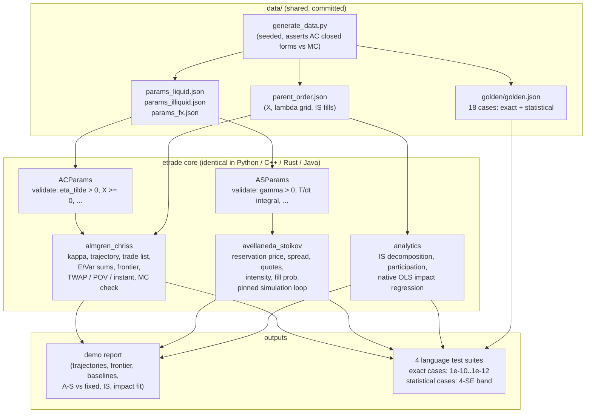
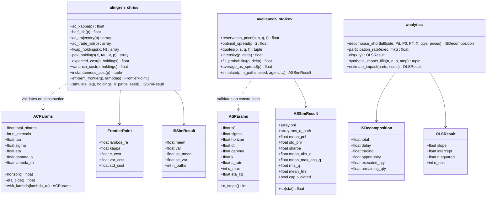

# ARCHITECTURE — `etrade`

Design notes for the four parallel implementations (Python reference, C++,
Rust, Java) of the Almgren-Chriss / Avellaneda-Stoikov / analytics stack.
The normative contract is `../API_SPEC.md`; this document explains *why* it
is shaped the way it is.

## 1. Component responsibilities

Three independent modules per language, mirrored one-to-one across ports:

| Module | Owns | Depends on |
|---|---|---|
| `almgren_chriss` | `ACParams` validation, `kappa`, sinh/TWAP trajectory, trade lists, exact discrete E/Var sums, TWAP/POV/instantaneous baselines, efficient frontier, Monte Carlo IS check | RNG (MC only) |
| `avellaneda_stoikov` | `ASParams` validation, reservation price / optimal spread / quotes closed forms, intensity and fill probability, the pinned path simulation with inventory cap, stress vol and terminal liquidation, per-path and aggregate statistics | RNG (simulation only) |
| `analytics` | Perold IS decomposition (buy/sell), participation rate, native closed-form OLS, pinned RNG-free synthetic impact fills | nothing stochastic |

The modules do not import each other. Parameter objects are immutable value
types (frozen dataclasses in Python, plain structs/records elsewhere) that
validate **at construction**, so every downstream function can assume valid
inputs and stay branch-free. The only shared state anywhere is the RNG
inside a single simulation call.

### Data flow



`generate_data.py` is the single source of truth for the bundled JSON: it
writes the parameter sets, the parent order, and the golden values (after
asserting the AC closed forms against its own Monte Carlo), all seeded.
Ports never regenerate data; they only consume it.

### Module surface



## 2. The pinned A-S simulation loop

Cross-language reproducibility of a *stochastic* simulation is the hardest
part of this project. The loop below is pinned to the operation: any
reordering (quoting after the mid move, drawing `u_bid` before `u_ask`,
skipping a suppressed side's draw) produces statistically different — or
subtly stream-forked — results.

```mermaid
sequenceDiagram
    participant Sim as Simulator (per step i, t = i*dt)
    participant Agent as Quoting agent ("as" / "fixed")
    participant RNG as RNG (pinned draw order)
    participant Mkt as Market state (s, q, cash)

    Note over Sim,Mkt: one step of the pinned loop (Section 2.2 of API_SPEC)
    Sim->>Agent: 1. quote(s, q, T - t)
    Agent-->>Sim: r, spread  (as: r = s - q*gamma*sigma^2*(T-t);<br/>fixed: r = s, fixed spread)
    Sim->>Sim: ask = r + spread/2, bid = r - spread/2
    Sim->>Sim: cap rule: quote bid iff q < q_max, ask iff q > -q_max
    Sim->>RNG: 2. draw u_ask, then u_bid (ALWAYS both, even if a side suppressed)
    RNG-->>Sim: u_ask, u_bid ~ U(0,1)
    Sim->>Sim: side fills iff quoted and u < 1 - exp(-A*exp(-k*delta)*dt)
    Sim->>Mkt: 3. ask fill: q -= 1, cash += ask;  bid fill: q += 1, cash -= bid
    Sim->>RNG: 4. draw z ~ N(0,1)
    RNG-->>Sim: z
    Sim->>Mkt: s += sigma_t*sqrt(dt)*z  (sigma_t stressed for t >= stress_time_frac*T)
    Note over Sim,Mkt: after last step: PnL = cash + q*S_T - eta_liq*|q|
```

Design points:

- **Always-draw rule.** Both uniforms are consumed every step regardless of
  the cap state, so the random stream is a pure function of
  `(seed, n_paths, n_steps)` and does not fork the first time a path hits
  `q_max`. This makes the A-S vs fixed-spread comparison a controlled
  experiment on the *same* randomness per (seed, agent).
- **Cap by construction.** The bid is suppressed at `q >= q_max`, the ask at
  `q <= -q_max`, so `|q| <= q_max` is an invariant, and the simulation still
  *asserts* it every step (`cap_violated` flag) — belt and braces, and a
  cheap tripwire for port bugs.
- **Stress as misspecification.** `stress_factor` scales only the realised
  `sigma_t` in step 4; the agent's formulas keep the base sigma. This
  isolates "the world changed and the model didn't notice" from "the model
  was re-calibrated".
- **Vectorisation across paths.** Python draws per-step *vectors* across
  paths (`u_ask` vector, `u_bid` vector, `z` vector) — ~200 numpy ops per
  simulated step instead of a million Python-level iterations. Native ports
  loop per path with the same *logical* per-step draw order; that is exactly
  why cross-language agreement is defined statistically, not bitwise.

## 3. Numerical design decisions and trade-offs

1. **Exact discrete sums, never continuous approximations.** `E[IS]` and
   `Var[IS]` are always evaluated through
   `(1/2)gamma_p X^2 + (eta_tilde/tau) sum n_j^2` and
   `sigma^2 tau sum x_j^2`. The paper's hyperbolic closed forms are
   continuous-time approximations that deviate at small N far above the
   1e-10 golden tolerance. One code path for optimal, TWAP and POV
   schedules also means one set of invariants to test.
2. **`arccosh` for kappa.** `kappa = arccosh(1 + kappa_tilde^2 tau^2/2)/tau`
   is the exact root of the discrete characteristic equation — no iterative
   solve, no tolerance to pin, and it degrades gracefully to
   `kappa ~ kappa_tilde` as `tau -> 0`.
3. **Explicit TWAP limit branch.** The sinh ratio is 0/0 at `kappa = 0`, so
   `kappa*T < KAPPA_T_LIMIT = 1e-6` switches to the exact linear schedule.
   The threshold is pinned in the spec (a port choosing 1e-8 would still
   pass goldens today, but the branch point is observable in principle, so
   it is contract, not implementation detail). Continuity across the branch
   is a dedicated test.
4. **`x_N = 0` exactly.** The last holding is forced to zero after
   evaluating either branch, so "fully liquidates" is exact rather than
   epsilon-true, and the liquidation check `|x_N| <= 1e-9 max(1, X)` on
   user-supplied schedules never trips on our own output.
5. **`log1p` / `expm1` everywhere they matter.** The A-S markup
   `(2/gamma) ln(1 + gamma/k)` and fill probability `1 - exp(-lambda dt)`
   are computed as `log1p` and `-expm1`; with FX-scale inputs
   (`gamma/k = 0.05`, `lambda*dt ~ 1e-3`) naive forms lose enough digits to
   break 1e-12 goldens.
6. **ddof = 1 sample moments, pinned SE formulas.** SE of a per-path-mean
   statistic is `sample std / sqrt(M)`; `SE(std_pnl)` and `SE(var)` use the
   normal approximation (`std/sqrt(2(M-1))`, `var*sqrt(2/(M-1))`). Pinning
   the SE formulas is what makes the 4-SE acceptance band well defined
   across languages.
7. **Money in whole currency units, shares in floats.** No basis-point or
   per-share normalisation inside the core: E and Var come out in currency,
   letting the golden values assert the raw sums. Reporting layers (demo)
   do the pretty-printing.
8. **RNG policy.** Determinism is per-language, agreement is statistical.
   Python: `numpy.random.default_rng(seed)` (PCG64); C++
   `std::mt19937_64`; Rust `rand`; Java `Random`/splittable. Each language
   tests "same seed twice = identical results"; the golden file stores
   Python's 20k-path references *with standard errors* so any port with
   `M >= 2000` paths can verify `|stat - ref| <= 4 sqrt(se_ref^2 + se_own^2)`.

## 4. Error-handling strategy per language

All input violations are detected at parameter construction or function
entry, reported with a specific message, and never clamped or deferred:

| Language | Mechanism | Notes |
|---|---|---|
| Python | `raise ValueError(msg)` | `_require(cond, msg)` helper; dataclass `__post_init__` validation |
| C++ | `throw std::invalid_argument` | `std::domain_error` specifically for the `gamma_p*tau >= 2*eta` model-validity failure |
| Rust | `Result<_, EtradeError>` | manual thiserror-style enum; no panics on bad input; `?` propagation in demo/tests |
| Java | `throw IllegalArgumentException(msg)` | checked eagerly in constructors and static entry points |

The checked conditions are enumerated in `API_SPEC.md` Section 6. Just as
important is the pinned list of **non-errors**: negative prices (arithmetic
walk), `kappa = 0` (half-life reported as infinity), signed quote distances
(`delta < 0` when skew pushes a quote through the mid), and `q_max = 0`
(quotes nothing, PnL identically zero). Turning any of these into an
exception is a port bug that the tests catch.

## 5. Testing strategy

Four layers, replicated per language (~25+ assertions each):

1. **Golden values** (`data/golden/golden.json`, 18 cases).
   *Exact* cases (tol 1e-10..1e-12, relative for large magnitudes via
   `tol*max(1,|expected|)`) pin the closed forms: AC solutions on two
   parameter sets, TWAP/POV/instant costs, a frontier point, the
   `lambda_ra = 0` = TWAP identity, A-S reservation/spread/fill
   probability, both IS decompositions, participation, and the impact
   regression on the pinned RNG-free synthetic fills.
   *Statistical* cases carry the Python 20,000-path reference plus SE per
   statistic; ports compare within the combined 4-SE band using their own
   RNG.
2. **Property-style invariants** (grid loops): optimal sell trajectory
   monotone decreasing and summing to X (1e-12); higher `lambda_ra` gives
   front-loaded schedules, higher E, lower Var (frontier monotonicity);
   trade list matches the cosh identity; sinh/TWAP branch continuity near
   the threshold; A-S spread positive and decreasing to the terminal floor;
   reservation price below mid when long; inventory cap invariant on every
   step; A-S rms inventory below fixed-spread rms inventory with margin;
   IS components summing to the total exactly.
3. **Monte Carlo vs closed forms**: AC sample mean/variance within 3-4 SE
   of the exact sums; the A-S comparison run on a reduced path count in
   tests to stay under the per-language 60 s budget.
4. **Error paths and determinism**: every validation rule of Section 6 has
   a negative test; every simulation is run twice with the same seed and
   asserted bitwise-identical within the language.

## 6. Performance notes

- Closed-form AC quantities are O(N) with trivial constants; the frontier
  sweep is O(N * grid) — microseconds. Nothing to optimise.
- The A-S simulation dominates runtime: O(n_paths * n_steps) with two
  uniforms, one normal, and a handful of exp calls per path-step. Python
  vectorises across paths (20,000 x 200 steps in ~1 s); native ports loop
  per path and are comfortably faster single-threaded; none parallelise —
  determinism and portability outrank speed here (2-CPU budget, tests
  < 60 s per language with reduced path counts).
- `exp` is the hot function in the A-S loop. The intensity for a suppressed
  side is still computed (branch-free style) in the reference; ports may
  skip it *only* where it cannot change results or draw order.
- Memory: per-path aggregates are accumulated on the fly (sums of |q|,
  q^2, running max), so the simulation stores O(n_paths) state, not
  O(n_paths * n_steps) paths. The MC IS check allocates its
  `(n_paths, N)` normal block up front in Python purely for draw-order
  pinning; native ports draw per step and stay O(n_paths).
